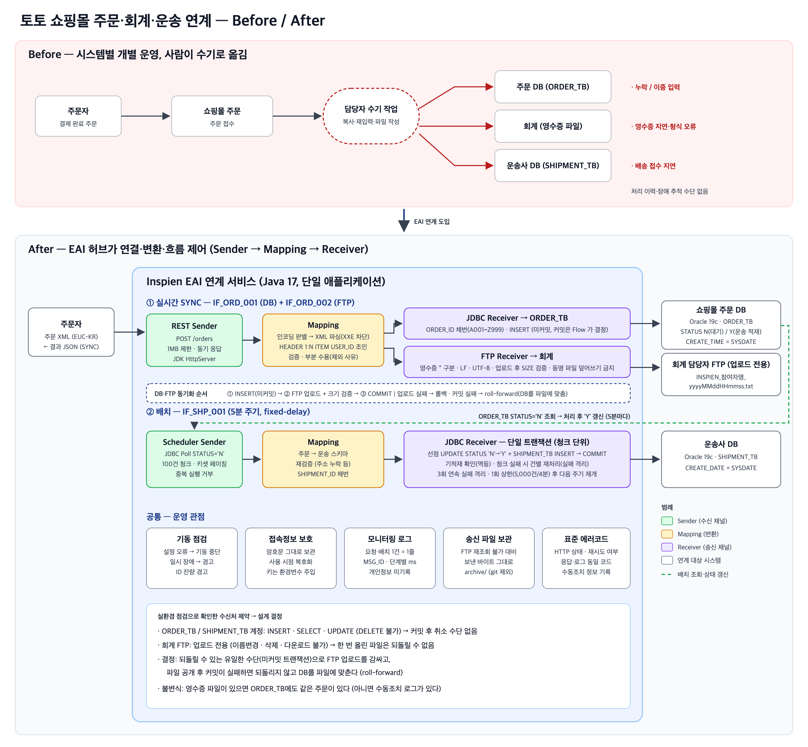

# 인스피언 EAI 과제 — 주문·영수증·운송 연계

온라인 쇼핑몰 "토토"의 주문(REST) → 주문 DB(JDBC) + 회계 영수증(FTP), 주문 DB → 운송사 DB(5분 배치) 연계를
**Sender → Mapping → Receiver** 구조의 Java 애플리케이션으로 구현했습니다. 웹 프레임워크 없이 필요한 라이브러리만 사용합니다.



> 원본: [docs/diagrams/architecture.html](docs/diagrams/architecture.html) · 확장성·부하 측정: [docs/scalability.md](docs/scalability.md) · **운영 설계(Kafka·Outbox·클러스터링): [docs/production-design.md](docs/production-design.md)** · AI 활용 기록: [docs/ai-usage.md](docs/ai-usage.md)

---

## 1. 인터페이스 정의서

| IF ID | 유형 | Sender | Mapping | Receiver | 처리 |
|---|---|---|---|---|---|
| **IF_ORD_001** | 실시간 SYNC | REST `POST /orders` (주문 XML) | XML(HEADER 1:N ITEM) → 플랫 주문 행 | JDBC → `ORDER_TB` | 결과 JSON 동기 반환 |
| **IF_ORD_002** | 실시간 SYNC (IF_ORD_001과 한 흐름) | 〃 | 주문 행 → `^` 구분 영수증 파일 | FTP → 회계 담당자 | DB와 함께 성공해야 성공 |
| **IF_SHP_001** | 배치 (5분, fixed-delay) | Scheduler + JDBC Poll (`ORDER_TB` `STATUS='N'`) | 주문 → 운송 스키마 | JDBC → `SHIPMENT_TB` + `ORDER_TB.STATUS='Y'` | 청크 단위, 단일 트랜잭션 |

### 필드 매핑

**ORDER_TB** (주문 XML → 한 ITEM 당 한 행)

| 컬럼 | 원천 | 비고 |
|---|---|---|
| ORDER_ID | 채번 | `[A-Z][0-9]{3}`, A001 → A999 → B000 … Z999 (지원자 키별) |
| APPLICANT_KEY | 제공 지원자 키 | 고정값 |
| USER_ID | `ITEM/USER_ID` | **HEADER와의 조인 키** (문서 내 위치 무관) |
| ITEM_ID / ITEM_NAME / PRICE | `ITEM/*` | PRICE 숫자 검증 |
| NAME / ADDRESS | `HEADER/*` | |
| STATUS | `HEADER/STATUS` | trim (원본에 개행·공백 포함 가능) |
| CREATE_TIME | DB 기본값 `SYSDATE` | 넣지 않음 — 시연 "당일 조회"에 사용 |

**영수증 파일** — `INSPIEN_참여자명_yyyyMMddHHmmss.txt`, UTF-8, 개행 LF 고정
```
ORDER_ID^USER_ID^ITEM_ID^APPLICANT_KEY^NAME^ADDRESS^ITEM_NAME^PRICE\n
```

**SHIPMENT_TB** — `SHIPMENT_ID`(채번, 같은 규격) · `APPLICANT_KEY` · `ORDER_ID` · `ITEM_ID` · `ADDRESS` ← ORDER_TB, `CREATE_DATE`는 DB 기본값

---

## 2. 실행 방법

**요구사항**: JDK 17 이상 (빌드 산출물은 `--release 17`), 인터넷(최초 의존성 다운로드). Gradle Wrapper 포함.

```bash
cp .env.example .env              # 이름·전화번호·이메일·제공 정보 API 인증정보 입력 (git 제외 파일)
./gradlew fetchInfo               # 제공 정보 수신 → secrets/received.json (암호문 그대로 보관), 샘플 XML 저장
./gradlew connCheck               # (선택) DB·FTP 접속·스키마 점검 — 읽기 전용
./gradlew run                     # 서비스 기동 (기동 점검 → REST 8080 + 운송 배치 5분 주기)
./scripts/demo.sh                 # 시연: 상태·오류 케이스·배치 수동 실행·로그 요약 (쓰기 없음)
./scripts/demo.sh --order         # 시연: + 실제 샘플 주문 전송 (DB 적재 + FTP 업로드)
./gradlew test                    # 테스트 (운영 DB 미사용 — H2 Oracle 모드 + 가짜 FTP)
./gradlew loadTest                # 로컬 부하 측정 (운영 서버에 절대 부하 금지 — 결과: build/load-test/result.md)
```

| 환경변수 (`.env` 또는 OS) | 기본값 | 설명 |
|---|---|---|
| `APPLICANT_NAME` / `APPLICANT_PHONE` / `APPLICANT_EMAIL` | — | 제공 정보 요청값. **전화번호는 접속정보 복호화 키** |
| `INSPIEN_API_USER` / `INSPIEN_API_PASSWORD` | — | 제공 정보 API Basic 인증 (`fetchInfo` 에서만 사용) |
| `SERVER_PORT` | 8080 | REST 포트 |
| `ORDER_MAX_CONCURRENT` | 8 | 주문 동시 처리 상한 — 초과 요청은 처리 전 즉시 `503 OVERLOADED` |
| `SHIPMENT_INTERVAL_SEC` / `SHIPMENT_INITIAL_DELAY_SEC` | 300 / 10 | 배치 주기 / 기동 후 첫 실행 지연 |
| `RECEIPT_CHARSET` | UTF-8 | 영수증 파일 인코딩 (수신측 요구 시 `EUC-KR`) |
| `PROVISION_FILE` / `LOG_DIR` | `secrets/received.json` / `logs` | |

시연 조회 SQL: [scripts/demo.sql](scripts/demo.sql) (당일 주문·운송 조회, 상태 요약, 정합성 점검)

---

## 3. API

### `POST /orders` — 주문 XML 수신 (IF_ORD_001/002)
- 본문: 주문 XML. 인코딩 판별 순서 `Content-Type charset` → XML 선언 → UTF-8 → EUC-KR(제공 샘플 원본 인코딩)
- 루트 엘리먼트가 없는 형태(제공 샘플)도 처리. DTD/외부 엔티티(XXE) 차단, 최대 1MB

```bash
curl -X POST -H 'Content-Type: application/xml; charset=EUC-KR' --data-binary @order-euckr.xml localhost:8080/orders
```
```json
{
  "msgId": "f2c8f88b-…", "interfaceId": "IF_ORD_001",
  "resultCode": "PARTIAL_SUCCESS", "message": "주문 63건 적재·영수증 전송, 11건 제외",
  "errorCode": null,
  "receivedHeaderCount": 15, "receivedItemCount": 70, "processedCount": 63, "excludedCount": 11,
  "receiptFile": "INSPIEN_홍길동_20261016173657.txt",
  "orderIds": ["A127", "…", "A189"],
  "excluded": [{ "level": "ITEM", "userId": "USER16", "itemId": "ITEM56", "reason": "NO_HEADER", "detail": "주문자(HEADER) 정보 없음" }, "…"]
}
```
- `resultCode`: `SUCCESS` / `PARTIAL_SUCCESS`(일부 제외) / `FAIL`. 실패 시 `errorCode`, `retryable` 포함
- **부분 수용 정책**: 조인·검증을 통과한 행만 적재하고, 나머지는 사유와 함께 돌려줍니다
  (제공 샘플: HEADER 없는 ITEM 7건 `NO_HEADER`, ITEM 없는 HEADER 4건 `NO_ITEM`)

### `POST /batch/shipments/run` — 운송 배치 즉시 실행 (운영자 수동 실행)
실행 결과 JSON 반환. 주기 실행이 돌고 있으면 `409 SKIPPED`.

### `GET /health`
`{"status":"UP","ordersInFlight":3,"maxConcurrentOrders":8,"ordersRejected":0}` — 처리 중 건수가 상한에 붙어 있고 거절 수가 늘면 용량 한계 도달.

---

## 4. 설계 결정

### 4.1 실환경 점검으로 확인한 제약 (설계의 출발점)
구현 중 실제 서버에 대해 권한을 직접 확인했습니다.

| 수신처 | 허용 | 불가 |
|---|---|---|
| ORDER_TB / SHIPMENT_TB (동일 계정) | INSERT, SELECT, UPDATE | **DELETE** |
| 회계 FTP | STOR(업로드) | **RNTO(이름변경) 451, DELE(삭제) 550, RETR(다운로드) 550** |

→ **두 수신처 모두 한 번 쓰면 되돌릴 수 없습니다.** 초안이던 "임시파일 업로드 → 커밋 → rename, 실패 시 행 삭제 보상"은
이 환경에서 성립하지 않아 폐기했습니다.

### 4.2 시나리오 1 — DB + FTP 동기화
되돌릴 수 있는 유일한 수단(**커밋 전 DB 트랜잭션**)으로 되돌릴 수 없는 FTP 업로드를 감쌉니다.

```
DECODE → PARSE → MAP → ID_ALLOC → JDBC_INSERT(미커밋) → RECEIPT_MAP → FTP_UPLOAD(+SIZE 검증) → ARCHIVE → COMMIT
```

| 실패 지점 | 처리 | 최종 상태 | 재전송 |
|---|---|---|---|
| 파싱·검증 | 즉시 실패 응답 | 아무것도 안 씀 | 데이터 수정 후 |
| DB 연결·INSERT | 롤백 | 아무것도 안 씀 | 가능 |
| FTP 연결·업로드 | DB 롤백. 전송 중 끊겨 부분 파일이 남았을 수 있으면 `manualAction` 기록 | DB 미적재 | 가능 |
| 업로드 후 COMMIT | 파일은 이미 공개 → **roll-forward**: 새 연결로 해당 ORDER_ID 존재 확인 → 있으면 "커밋 성공·응답 유실", 없으면 같은 ID로 재적재 | DB = 파일 | 불필요(성공 응답) |
| roll-forward 실패 | `RECOVERY_FAILED` + `manualAction`(파일명·ID 범위) | 파일만 존재 | **금지** |

**불변식**: 영수증 파일이 공개됐다면 ORDER_TB에도 같은 주문이 있다 (아니면 수동조치 로그가 있다).
그 밖에: 같은 초 요청의 파일명 충돌 방지, 서버에 같은 이름이 있으면 덮어쓰지 않고 다음 초 이름 사용,
FTP 재조회가 불가하므로 **보낸 바이트를 `archive/`에 그대로 보관**(증빙·재전송 근거, 개인정보 포함으로 git 제외).

### 4.3 시나리오 2 — 운송 배치
인사연동 모듈 운영 중 겪은 **대용량(30만 건) 처리 장애와, 장애 이후 원인 파악·복구가 오래 걸렸던 경험**을 설계 원칙으로 삼았습니다.

| 원칙 | 구현 |
|---|---|
| 메모리는 데이터 양과 무관해야 한다 | 100건 청크 조회·커밋, 키셋 페이징. 1회 상한(5,000건·4분) 초과분은 다음 주기 |
| 적재 성공한 건만 Y | 같은 계정 → INSERT + UPDATE 단일 트랜잭션 (계정이 다르면 기동 중단) |
| 다시 돌려도 안전해야 한다 | 선점 `UPDATE … SET STATUS='Y' WHERE … AND STATUS='N'` + 기적재 확인(있으면 상태만 보정) |
| 한 건이 전체를 멈추면 안 된다 | 청크 실패 → 그 청크만 건별 재처리해 원인 건만 남김 |
| 같은 실패가 매번 반복되면 안 된다 | 3회 연속 실패 건 격리 → 수동조치 로그 |
| 중단돼도 이어서 재개 | 상태 정본은 DB(STATUS). 연결 장애 시 처리분은 커밋 유지, 다음 주기가 남은 N부터 |
| 배치가 조용히 죽으면 안 된다 | `ScheduledExecutorService`는 작업 예외 시 **이후 주기를 조용히 취소** → 모든 Throwable 차단. 대상 없음도 1줄 로그(하트비트) |
| 겹쳐 돌면 안 된다 | fixed-delay + 실행 중 플래그(수동 실행과도 상호 배제), 종료 시 청크 경계에서 중지 |

### 4.4 부하 — 비동기·부하분산 대신 과부하 차단
쇼핑몰이니 비동기·부하분산이 필요한지 **로컬 부하 측정**(실서버 지연 주입, 운영 서버 미사용)으로 검토했습니다. 자세한 서사: [docs/scalability.md](docs/scalability.md)

| 10건/초 몰림 (15초) | 성공 응답 p95 | 거절 응답 | **처리됐지만 주문자는 타임아웃** |
|---|---|---|---|
| 과부하 차단 없음 | 28.2초 | - | **38건** (재전송 시 중복 적재·중복 영수증) |
| 과부하 차단 (동시 8건) | 2.8초 | 7ms에 503 (102건) | **0건** |

- 실시간 주문은 과제가 SYNC 계약을 명시 → 비동기 전환은 하지 않음(계약 변경 사항)
- 병목은 서버가 아니라 **FTP 접속 대기(2.4초)**, 그리고 **초 단위 영수증 파일명**(초당 1건만 넘어도 파일명 시각이 밀림 — 평시 2건/초에서 15초간 14초) → 서버를 늘려서는 풀리지 않음
- 대신 처리 전 즉시 거절하는 과부하 차단을 넣어 "처리됐는지 모르는 주문"을 없앰
- 피크 1,000건/초를 가정한 운영 설계(동기 구간 축소, Transactional Outbox, Kafka, 영수증 시간창 집계, 클러스터링·부하분산, 장애 시나리오, 계약 협의 항목): [docs/production-design.md](docs/production-design.md)

### 4.5 공통
- **기동 점검**: 계정·테이블·컬럼·FTP 경로 오류는 기동 중단(재시도로 해결 불가), 네트워크 단절은 경고 후 기동(런타임 재시도), ID 잔여량 경고
- **접속정보 보호**: 제공 응답을 **암호문 그대로** 보관하고 사용 시점에만 복호화(AES-128/ECB, 키 = SHA-1(전화번호) 앞 16바이트).
  키는 환경변수로 주입. 접속정보 객체의 `toString()`과 모든 도구 출력은 주소·계정·비밀번호를 가림
- **재시도**: DB·FTP 연결은 짧은 백오프(0.3s, 1s) 재시도 — 동기 API라 총 대기 상한을 둠. 계정 오류는 재시도하지 않음
- **ID 채번**: 프로세스 내 동시 요청은 메모리 상한으로 겹침 방지, 외부 충돌은 PK가 최종 방어선(중복키 → DB 최대값 재동기화 후 재시도),
  롤백된 ID는 재사용하지 않음(결번 허용), 소진 시 명시적 실패

---

## 5. 에러코드

| errorCode | HTTP | 재시도 | 의미 |
|---|---|---|---|
| `XML_PARSE` | 400 | ✗ | XML 형식 오류 / HEADER·ITEM 없음 / DTD 포함 |
| `UNSUPPORTED_ENCODING` | 400 | ✗ | 선언된 charset 으로 해석 불가 |
| `NO_VALID_RECORD` | 422 | ✗ | 조인·검증 통과 행 없음 (제외 사유는 `excluded`) |
| `PAYLOAD_TOO_LARGE` / `METHOD_NOT_ALLOWED` | 413 / 405 | ✗ | |
| `OVERLOADED` | 503 | ✓ | 동시 처리 상한 초과 — **처리 시작 전 거절**, `Retry-After: 1`. 아무것도 쓰지 않았으므로 재전송 안전 |
| `DB_CONNECTION` / `DB_TIMEOUT` | 503 | ✓ | 일시 장애 — 잠시 후 재전송 |
| `DB_DUPLICATE_KEY` | 500 | ✓ | 외부 충돌로 재시도 한도 초과 |
| `DB_ERROR` | 500 | ✗ | 기타 DB 오류 |
| `FTP_CONNECTION` / `FTP_TRANSFER` | 503 / 502 | ✓ | FTP 장애 — DB는 롤백됨 |
| `ID_EXHAUSTED` | 500 | ✗ | 지원자 키의 ID 한도(25,999) 소진 |
| `RECOVERY_FAILED` | 500 | ✗ | **파일 공개 후 DB 반영 실패 — 재전송 금지, 수동조치** |
| `INTERNAL` | 500 | ✗ | 예상치 못한 오류 |

---

## 6. 모니터링 로그

`logs/interface-yyyy-MM-dd.log` — **요청 1건 / 배치 실행 1회 = JSON 1줄**. 응답의 `msgId`로 바로 찾을 수 있습니다.
개인정보(이름·주소)는 기록하지 않습니다.

```json
{"timestamp":"2026-10-16T17:36:53+09:00","msgId":"…","interfaceId":"IF_ORD_001","type":"REALTIME","sender":"REST",
 "receivers":"JDBC:ORDER_TB,FTP:Recruit/2026/","resultCode":"PARTIAL_SUCCESS","durationMs":4014,
 "charset":"EUC-KR (Content-Type 선언)","receivedHeaders":15,"receivedItems":70,"processed":63,"excluded":11,
 "orderIdRange":"A127~A189","excludedByReason":{"NO_HEADER":7,"NO_ITEM":4},"receiptFile":"INSPIEN_…txt","errorCode":null,
 "steps":[{"step":"DECODE","status":"OK","ms":0},{"step":"PARSE","status":"OK","ms":14},…,{"step":"FTP_UPLOAD","status":"OK","ms":40},{"step":"COMMIT","status":"OK","ms":529}]}
{"timestamp":"2026-10-17T16:40:53+09:00","msgId":"…","interfaceId":"IF_SHP_001","type":"BATCH","trigger":"SCHEDULE",
 "resultCode":"SUCCESS","durationMs":785,"fetched":189,"shipped":189,"repaired":0,"skipped":0,"failed":0,"chunks":2,
 "shipmentIdRange":"A001~A189","failures":[]}
```
기동 시 점검 결과도 `"interfaceId":"SYSTEM","type":"STARTUP"` 레코드로 남습니다(`checks` 배열).
`steps`의 마지막 `FAIL` 단계가 장애 지점이고, `detail`에 에러코드가 남습니다. 사람이 처리해야 할 건은 `manualAction` 필드로 표시됩니다.

---

## 7. 운영 가이드 — 장애 유형별 확인 → 조치

| 증상 | 확인 | 조치 |
|---|---|---|
| 기동 직후 종료 (`[FATAL]`) | 기동 점검 출력의 ✗ 항목 | 계정·테이블·FTP 경로 설정 확인. 복호화 실패면 `APPLICANT_PHONE`이 요청 시 값과 같은지 |
| 주문 `FTP_CONNECTION`/`FTP_TRANSFER` 급증 | 로그 `steps` 에서 `FTP_CONNECT`/`FTP_UPLOAD` FAIL | FTP 서버 상태 확인. DB는 롤백돼 있으므로 복구 후 **재전송** |
| `manualAction`: "불완전 파일 잔존 가능" | 로그의 파일명 | 삭제 권한이 없으므로 수신측(회계)에 해당 파일 무시 요청. DB는 롤백됨 |
| `RECOVERY_FAILED` | `manualAction`의 파일명·ORDER_ID 범위, `archive/receipt/<날짜>/<파일명>` | **재전송 금지**. 보관 파일 내용대로 ORDER_TB 수동 적재 → [scripts/demo.sql](scripts/demo.sql) 정합성 쿼리로 확인 |
| 배치 로그가 5분 넘게 안 찍힘 | 프로세스 생존, `GET /health` | 배치는 대상 없음(`NO_DATA`)도 매 주기 기록 → 로그 공백 = 프로세스 이상. 재기동 시 남은 N부터 자동 재개 |
| 배치 `FAIL DB_CONNECTION` | 로그 `errorMessage` | 처리분은 커밋됨. 조치 불필요 — 다음 주기 자동 재개 (반복되면 DB 점검) |
| 배치 `failures[].quarantined=true` | `orderId`, `detail` | 원천 데이터(ORDER_TB) 수정 후 재기동 → 격리 해제·재시도 |
| ID 잔여 경고 | 기동 점검 `잔여 n개` | 채번 규격 확장 협의 (현재 지원자 키당 25,999개) |
| 정합성 의심 | [scripts/demo.sql](scripts/demo.sql) 4번 쿼리 | `Y` 인데 운송 없음 / 운송 있는데 `N` 모두 0이어야 정상. N 잔존분은 배치 수동 실행(`POST /batch/shipments/run`) |

---

## 8. 테스트

`./gradlew test` — **40개**, 운영 DB·FTP를 쓰지 않습니다 (H2 Oracle 모드 + 업로드 전용 가짜 FTP).

| 영역 | 내용 |
|---|---|
| 매핑 | 루트 없는 XML, STATUS trim, 위치 무관 USER_ID 조인, 고아 ITEM·ITEM 없는 HEADER·중복 HEADER, 필드 검증(숫자·100바이트·구분자), XXE 차단, 인코딩 판별 |
| 채번 | 규격, 자리 올림(A999→B000), 소진 |
| 시나리오 1 장애 주입 | FTP 연결 실패, 업로드 거절, 전송 중 끊김(부분 파일), 커밋 실패 → roll-forward, 커밋 후 응답 유실 → 중복 없음, roll-forward 실패 → 수동조치, 파일명 충돌 |
| 시나리오 2 | 청크·NO_DATA, 멱등(기적재 보정), 검증 실패 격리, DB 오류 청크 → 건별 재처리, 연속 실패 격리, 실행 상한 → 재개, 중지 신호, 타 지원자 데이터 미접근, 연결 실패 |
| 스케줄러 | 예외 후에도 주기 지속, 실행 중 수동 실행 거부 |
| 과부하 차단 | 상한 초과 요청은 즉시 503·재시도 가능·아무것도 쓰지 않음, 처리 중이던 요청은 정상 완료 |

테스트가 잡아낸 실제 결함: ① roll-forward 시 원 트랜잭션 잠금으로 재적재가 막힘 ② **Oracle은 `''`를 NULL로 취급** —
키셋 페이징 첫 조건 `ORDER_ID > ''`가 항상 거짓이 되어 배치가 오류 없이 영원히 "대상 없음"이 되는 문제.

---

## 9. 프로젝트 구조

```
src/main/java/com/inspien/eai/
  EaiApplication          조립·기동 (기동 점검 → Flow 조립 → Sender 시작)
  sender/                 RestSender(POST /orders·과부하 차단, 배치 수동 실행), BatchScheduler ← Sender Channel
  mapping/                PayloadDecoder, OrderXmlParser, OrderFlattener, ReceiptFileMapper, ShipmentMapper ← Mapping
  receiver/               JdbcOrderReceiver, FtpReceiptReceiver, JdbcShipmentReceiver       ← Receiver Channel
  flow/                   OrderSyncFlow(IF_ORD_001/002), ShipmentBatchFlow(IF_SHP_001)      ← iFlow / ICO
  model/                  OrderRecord(정규 모델), ReceiptFile, ShipmentRecord, ExcludedRecord …
  core/                   ErrorCode, EaiException, MessageContext(MSG_ID·단계 기록)
  id/                     SequentialIdFormat(규격), IdAllocator(DB 동기화 채번)
  infra/                  ConnectionFactory(재시도), SqlErrors(오류 분류), Preflight(기동 점검)
  monitor/                InterfaceLogWriter(모니터링 로그), OutboundArchive(송신 파일 보관)
  config/                 Env(.env/환경변수), ConnectionInfoCipher(복호화), ProvisionInfo
  tool/                   FetchProvisionInfo(fetchInfo), ConnectivityCheck(connCheck)
```
의존성: Jackson(JSON), commons-net(FTP), ojdbc11(Oracle, runtime) / 테스트: JUnit 5, H2

---

## 10. 보안

- 커밋 금지 대상: `.env`, `secrets/`(제공 응답·샘플), `logs/`, `archive/` — 모두 `.gitignore`
- 접속정보는 디스크에 암호문으로만 존재, 복호화 키(전화번호)는 코드·설정 파일에 없음
- 도구 출력·로그에 접속 주소·계정·비밀번호·개인정보 미기록 (`fetchInfo`의 평문 출력은 `-Preveal` 명시 시에만)
- 외부 XML 입력의 DTD·외부 엔티티 차단, 본문 크기 제한, 테이블·컬럼명 식별자 검증

## 11. 알려진 한계와 개선 방향

| 항목 | 현재 | 운영이라면 |
|---|---|---|
| 요청 중복 방지 | 같은 주문을 두 번 보내면 두 번 적재 | `Idempotency-Key` 헤더 + 처리 이력 테이블 |
| FTP 접속 시간 | 요청마다 접속(서버 응답 ~2.4초) → 동시 8건 기준 약 2.7건/초가 상한 | 세션 풀 재사용 ([확장 로드맵](docs/scalability.md#8-운영이라면--단계별-로드맵)) |
| 영수증 파일명 | 초 단위 — 초당 1건 넘으면 파일명 시각이 앞당겨짐 | 영수증 큐 + 1분 집계 전송 (회계와 계약 협의) |
| 수신처 계정 분리 | ORDER/SHIPMENT 동일 계정 전제(다르면 기동 중단) | 2단계 처리 + 멱등 확인 경로(현재 멱등 확인은 구현됨) |
| 다중 인스턴스 | 단일 인스턴스 전제(채번 메모리 상한) | DB 시퀀스/채번 테이블, 분산 락 |
| 격리 목록 | 메모리(재기동 시 해제) | 실패 이력 테이블 |
| 개발 중 잔여 파일 | 권한 확인 과정에서 생긴 `*.txt.tmp` 1개가 FTP에 남아 있음(삭제 권한 없음) | — |
