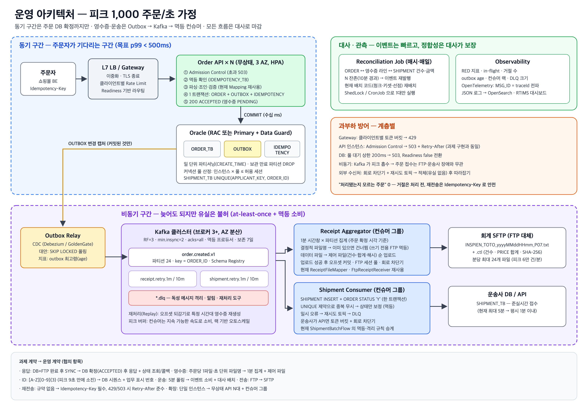

# 운영 설계 — 대규모 쇼핑몰을 가정한 주문·영수증·운송 연계

> 이 문서는 **과제 구현의 다음 단계**다. 과제는 명시된 계약(동기 응답, 주문당 영수증 1파일, 초 단위 파일명, 5분 배치, 4자리 ID)을
> 그대로 지켜 구현했다. 여기서는 토토가 "주문량이 급격히 늘어난" 쇼핑몰이라는 배경을 끝까지 밀고 가서,
> **그 계약들이 실제 부하에서 어디서 깨지는지 계산하고, 운영 환경이라면 어떻게 설계할지**를 정리한다.
>
> 관련 문서: [확장성 설계 노트(측정)](scalability.md) · [README](../README.md)



---

## 0. 한눈에 보기

| 영역 | 과제 구현 (계약 준수) | 운영 설계 |
|---|---|---|
| 주문 응답 | DB 커밋 + FTP 업로드까지 끝나야 응답 (SYNC) | **DB 커밋까지만 동기**, 영수증·운송은 이벤트로 비동기 |
| DB ↔ 메시지 정합성 | 미커밋 트랜잭션으로 FTP 업로드를 감쌈 + roll-forward | **Transactional Outbox** — 주문과 이벤트를 같은 트랜잭션에 기록 |
| 메시지 백본 | 없음 (직접 호출) | **Kafka** (주문 이벤트 스트림) + 재시도 토픽·DLQ |
| 영수증 | 주문 1건 = 파일 1개, 초 단위 파일명 | **시간창 집계 파일**(1분) + 제어 파일(건수·합계), 결정적 파일명으로 멱등 |
| 운송 연계 | 5분 폴링 배치 | **이벤트 소비**(준실시간) + 폴링 배치는 **대사(누락 보정)** 용으로 격하 |
| ID | `[A-Z][0-9]{3}` 메모리 채번 (지원자당 25,999개) | DB 시퀀스 / 시간 정렬 ID — 업무 표시용 번호는 별도 협의 |
| 중복 요청 | 재전송 시 중복 적재 | **Idempotency-Key** + 처리 이력 |
| 확장 | 단일 인스턴스 | 무상태 API N대 + L7 부하분산 + 컨슈머 그룹 수평 확장 |
| 과부하 | 동시 처리 상한 → 503 | 클라이언트별 Rate Limit + 인스턴스 Admission Control + Kafka 버퍼 + 컨슈머 랙 기반 오토스케일 |
| 관측 | JSON 로그 1줄/요청 | 메트릭(RED·컨슈머 랙·아웃박스 지연) + 분산 추적(MSG_ID 전파) + 일일 대사 리포트 |

---

## 1. 부하 가정

토토의 규모를 다음과 같이 가정한다. (실제 설계에서는 과거 주문 데이터·마케팅 일정으로 확정한다.)

| 항목 | 가정 | 근거·비고 |
|---|---|---|
| 평시 | 50 주문/초 | 일 약 200만 주문 수준의 성장한 쇼핑몰 |
| **피크** | **1,000 주문/초, 10분 지속** | 타임세일·라이브커머스 등 이벤트 시작 직후 |
| 주문당 상품 수 | 평균 3개 | → 피크 시 **3,000 행/초** INSERT |
| 메시지 크기 | 주문 이벤트 약 1KB | 피크 1MB/초 — Kafka 기준으로는 작은 부하 |
| 목표 (SLO) | 주문 접수 p99 < 500ms, 가용성 99.95% | 접수 = DB 확정 |
| 영수증 전달 | 평시 1분 이내, 장애 시에도 **유실 0** | 지연은 허용, 유실은 불허 |
| 운송 접수 | 평시 1분 이내 (현재 최대 5분) | |

## 2. 과제 계약이 이 부하에서 깨지는 지점

| 과제 계약 | 피크(1,000건/초)에서 | 근거 |
|---|---|---|
| **동기 응답이 FTP 업로드를 포함** | 주문 접수 가용성이 **FTP 서버 가용성에 묶인다**. FTP가 1분 멈추면 주문 6만 건이 실패 | 측정: FTP 접속만 2.4초. 회계 시스템 장애가 매출 손실로 직결 |
| **주문 1건 = 영수증 파일 1개** | 초당 1,000개 파일 → 하루 8천만 개(피크 지속 가정 시). 회계가 처리할 수 없는 단위 | 파일 단위 오버헤드(접속·디렉터리 엔트리)가 데이터보다 큼 |
| **초 단위 파일명** | 초당 1건만 넘어도 파일명 시각이 밀린다 | 측정: 2건/초에서 15초간 14초, 50건/초에서 488초 |
| **ID `[A-Z][0-9]{3}`** | 25,999개 → 3,000행/초면 **약 9초 만에 소진** | 형식 자체가 테스트 규모 |
| **5분 폴링 배치** | 5분마다 30만 행을 한꺼번에 처리 → 부하가 몰리고 운송 접수 최대 5분 지연. STATUS 갱신이 주문 INSERT와 같은 테이블에서 경합 | 폴링은 "변경 감지"를 테이블 스캔으로 대신하는 방식 |
| **단일 인스턴스** | 장애 시 전체 중단, 처리량은 FTP 대기에 묶여 약 2.7건/초 | 측정 (scalability.md) |

이 계약들은 과제 범위에서는 타당하다 — 연계 구조를 검증하기 위한 단순화다. 운영에서는 **바꿔야 하는 계약**이고,
그 변경은 개발자가 단독으로 하는 것이 아니라 송·수신 시스템 담당자와 **협의할 항목**이다 (§12).

---

## 3. 핵심 설계 원칙

1. **System of Record에 확정되면 "접수"다.** 주문의 진실은 주문 DB다. 영수증·운송은 확정된 주문에서 파생되는 **후속 처리**이고, 늦어질 수는 있어도 유실되어선 안 된다.
2. **동기 경계를 최소화한다.** 주문자가 기다리는 구간에는 꼭 필요한 시스템(주문 DB)만 둔다. 외부 시스템(회계 FTP, 운송사)의 장애가 주문 접수를 막지 않게 한다.
3. **Dual write 금지.** "DB에 쓰고 메시지도 보낸다"를 두 번의 독립된 쓰기로 하면 반드시 어긋난다. 하나의 트랜잭션에 기록하고, 전달은 그 기록을 따라간다 (Outbox).
4. **At-least-once 전달 + 멱등 소비.** Exactly-once는 전달이 아니라 **효과**로 만든다. 모든 소비자는 같은 메시지를 두 번 받아도 결과가 같아야 한다.
5. **되돌릴 수 없는 수신처에는 결정적으로 쓴다.** (과제에서 확인한 쓰기 전용 FTP) 재시도해도 같은 이름·같은 내용이 되게 만들고, 이미 있으면 건너뛴다.
6. **모든 흐름에 대사(Reconciliation)가 있다.** 이벤트 기반은 빠르지만, 최종 정합성은 주기적 대사로 보장한다. (인사연동 운영에서 "장애 이후 복구가 더 비쌌던" 경험의 교훈)

---

## 4. 목표 아키텍처

```
                        ┌──────────── L7 Load Balancer (TLS 종료, 헬스체크, 클라이언트별 Rate Limit) ────────────┐
주문자(쇼핑몰 FE/BE) ──▶ │                                                                                        │
                        └───────┬───────────────────────┬───────────────────────┬────────────────────────────────┘
                                ▼                       ▼                       ▼
                        Order API #1             Order API #2      …     Order API #N      (무상태, HPA)
                        ├ Idempotency-Key 확인
                        ├ 파싱·조인·검증 (현재 Mapping 재사용)
                        └ 단일 트랜잭션: ORDER_TB INSERT + OUTBOX INSERT + IDEMPOTENCY INSERT → COMMIT → 응답(접수 확정)
                                │
                     Oracle (RAC 또는 Primary/Standby, Data Guard)
                                │  OUTBOX
                                ▼
                     Outbox Relay (CDC: Debezium/GoldenGate, 또는 폴링 퍼블리셔 — 리더 1개)
                                │
                                ▼
            ┌──────────────── Kafka 클러스터 (브로커 3+, RF=3, min.insync=2, acks=all) ────────────────┐
            │  order.created.v1  (파티션 24, key = ORDER_ID)                                          │
            │  receipt.retry.1m / 10m  ·  shipment.retry.1m / 10m  ·  *.dlq                          │
            └────────┬──────────────────────────────────────────────┬────────────────────────────────┘
                     ▼                                              ▼
        Receipt Aggregator (컨슈머 그룹)                 Shipment Consumer (컨슈머 그룹)
        ├ 1분 시간창 × 파티션 단위 집계                    ├ SHIPMENT INSERT (UNIQUE: APPLICANT_KEY, ORDER_ID)
        ├ 결정적 파일명 → 존재하면 건너뜀(멱등)             ├ ORDER STATUS 'Y' (조건부 UPDATE)
        ├ 데이터 파일 → 제어 파일(건수·합계) 순서로 업로드   └ 실패 → 재시도 토픽 → DLQ
        └ FTP 세션 풀, 회로 차단기(Circuit Breaker)
                     ▼                                              ▼
              회계 FTP/SFTP                                    운송사 DB / API

        Reconciliation Job (매시·매일): ORDER ↔ 영수증 라인 ↔ SHIPMENT 건수·금액 대사 → 차이 리포트·자동 보정
        Observability: Prometheus 메트릭 · OpenTelemetry 추적(MSG_ID = traceId) · JSON 로그 → OpenSearch · 알림
```

### 4.1 주문 접수 (동기 구간)

```
POST /orders  (Idempotency-Key: 9b1c…)
  1. Rate Limit (LB/게이트웨이)          — 클라이언트별 초당 상한, 초과 429
  2. Admission Control (인스턴스)        — 동시 처리 상한, 초과 503 Retry-After  ← 현재 구현과 동일
  3. 멱등 확인: IDEMPOTENCY_TB 조회      — 같은 키·같은 본문 해시 → 저장된 응답 반환 / 같은 키·다른 본문 → 409
  4. 파싱·조인·검증                       — 현재 OrderXmlParser·OrderFlattener 그대로
  5. BEGIN
       INSERT ORDER_TB (행 N개, 배치 INSERT)
       INSERT OUTBOX (event_id, aggregate_id=ORDER_ID, type=order.created.v1, payload, created_at)
       INSERT IDEMPOTENCY_TB (key, request_hash, response, expires_at)
     COMMIT
  6. 200 { resultCode: ACCEPTED, orderIds, receipt: { status: PENDING, expectedBy: "…" } }
```
- 응답 시간은 **DB 커밋 1회**로 결정된다 — 커넥션 풀 기준 수십 ms. FTP·운송사 장애와 무관하다.
- 영수증·운송 진행 상태는 `GET /orders/{id}/status`로 조회하거나, 송신측이 원하면 콜백(Webhook)으로 알린다.
- **과제의 "DB·FTP 모두 처리 후 응답"을 이렇게 바꾸는 것이 가장 큰 계약 변경**이다. 바꿀 수 없다면 §11의 대안을 쓴다.

### 4.2 Transactional Outbox — 왜 필요한가
"DB 커밋 → Kafka 전송"을 순서대로 하면, 커밋 후 전송 직전에 프로세스가 죽을 때 **주문은 있는데 이벤트가 없다**(영수증 영구 누락).
반대로 "Kafka 전송 → DB 커밋"은 커밋 실패 시 **없는 주문의 영수증**이 나간다. 과제에서 DB·FTP 사이에 겪은 것과 **똑같은 이중 쓰기 문제**다.

Outbox는 이벤트를 주문과 **같은 DB 트랜잭션**에 기록해 이 문제를 없앤다. 전달은 별도 프로세스(Relay)가 OUTBOX를 읽어 Kafka로 보낸다.

| Relay 방식 | 장점 | 단점 | 선택 |
|---|---|---|---|
| CDC (Debezium Oracle 커넥터 / Oracle GoldenGate) | 폴링 부하 없음, 지연 낮음, 커밋 순서 보존 | 운영 구성 요소 추가, Oracle 로그 접근 권한(LogMiner/XStream) 필요 | **1순위** |
| 폴링 퍼블리셔 (`SELECT … FOR UPDATE SKIP LOCKED`) | 구현 단순, 권한 단순 | DB 폴링 부하, 지연 = 폴링 주기 | DBA 권한을 못 받을 때 |

- Relay는 at-least-once로 보낸다(전송 후 OUTBOX 표시 전에 죽으면 재전송) → **소비자 멱등이 전제**다.
- OUTBOX는 전송 완료 후 보존 기간(예: 7일) 뒤 파티션 단위로 삭제 — 대량 DELETE 대신 **파티션 DROP**.

### 4.3 메시지 백본 — Kafka vs RabbitMQ

| 기준 | Kafka | RabbitMQ |
|---|---|---|
| 처리량·버퍼 | 디스크 로그 기반, 피크를 길게 흡수 | 메모리 중심 큐, 적체가 길어지면 부담 |
| **재처리(Replay)** | 오프셋을 되돌려 **과거 이벤트 재소비** 가능 → 장애 후 영수증 재생성·대사에 결정적 | 소비되면 사라짐 (별도 보관 필요) |
| 다중 소비자 | 한 토픽을 영수증·운송·분석이 각자 소비 (팬아웃이 기본) | Exchange로 팬아웃 가능, 큐마다 복제 |
| 순서 | 파티션 내 순서 보장 (key = ORDER_ID) | 큐 내 순서, 경쟁 소비 시 깨짐 |
| 지연 재시도·우선순위 | 재시도 토픽으로 구현 | Delayed exchange, TTL+DLX, 우선순위 큐가 **기본 기능** |
| 메시지 단위 라우팅 | 약함 | 강함 (topic/header exchange) |

**선택: 주문 이벤트 백본은 Kafka.** 근거는 ①피크 흡수, ②**재처리** — 영수증은 "늦어도 되지만 유실되면 안 되는" 데이터라
FTP 장애 이후 특정 시간대를 다시 만들 수 있어야 한다, ③영수증·운송·향후 분석이 같은 이벤트를 독립적으로 소비한다.
RabbitMQ는 **작업 큐 성격**(예: 운송사 API 호출을 우선순위·지연 재시도로 다뤄야 하는 경우)이 강할 때 보조로 검토한다.
SAP Integration Suite 환경이라면 같은 역할을 **JMS Queue(EO/EOIO) 또는 Event Mesh**로, 사내 표준이 Kafka면 **Kafka Adapter**로 구성한다.

**Kafka 구성**
- 브로커 3대 이상(가용영역 분산), `replication.factor=3`, `min.insync.replicas=2`, 프로듀서 `acks=all`, `enable.idempotence=true`
- `order.created.v1` 파티션 24 — 컨슈머 최대 병렬도이자 이후 확장 여유. key = ORDER_ID (같은 주문의 이벤트 순서 보장)
- 스키마: Avro/JSON Schema + Schema Registry, 토픽 이름에 버전(`.v1`) — 하위 호환 규칙 강제
- 보존: 7일 (재처리 창)

### 4.4 영수증 — 시간창 집계 + 결정적 파일명

주문당 파일 1개를 **1분 시간창 × 파티션 단위 집계 파일**로 바꾼다.

```
파일명:  INSPIEN_<시스템>_<yyyyMMddHHmm>_P<파티션>.txt      예) INSPIEN_TOTO_202610171030_P07.txt
제어파일: 같은 이름 + .ctl   내용: 라인 수, PRICE 합계, 첫/마지막 ORDER_ID, 생성 시각, SHA-256
```
- **결정적 이름**: 시간창은 이벤트의 **주문 확정 시각** 기준(처리 시각이 아님) → 재처리해도 같은 파일에 같은 내용
- **멱등 업로드**: 쓰기 전용 FTP(과제에서 확인한 제약) 전제 — 같은 이름이 이미 있으면 업로드하지 않는다. 덮어쓰기도 삭제도 없다
- **완결성 신호**: rename이 불가능하므로 "데이터 파일 → 제어 파일" 순서로 올리고, 수신측은 **제어 파일이 있는 데이터 파일만** 처리한다. 제어 파일의 건수·합계로 수신측이 자체 검증
- **늦게 도착한 이벤트**: 시간창 마감(예: 창 종료 + 2분 워터마크) 이후 도착분은 다음 창이 아니라 `…_P07_LATE01.txt`로 분리 — 원 창 파일은 불변
- **커밋 순서**: 파일·제어 파일 업로드 성공 → **그 다음** Kafka 오프셋 커밋. 업로드 후 오프셋 커밋 전에 죽으면 재소비 → 파일이 이미 있으므로 건너뜀 → 멱등
- 파일 수: 파티션 24 × 분당 1개 = 분당 최대 24개 (피크 1,000건/초 = 분당 6만 건이 24개 파일로). 회계가 원하면 파티션 무관 분당 1개로 2단 집계
- FTP 측: **세션 풀**(접속 2.4초 제거), **회로 차단기** — 연속 실패 시 FTP 호출을 잠시 끊고 Kafka에 적체시킨다(주문 접수에는 영향 없음). 가능하면 **SFTP**로 전환(평문 FTP는 계정·데이터 노출)

### 4.5 운송 — 이벤트 소비 + 대사 배치

| 구성 | 역할 |
|---|---|
| Shipment Consumer | `order.created.v1` 소비 → SHIPMENT INSERT + ORDER STATUS 'Y' (같은 DB면 한 트랜잭션) |
| 멱등 | SHIPMENT_TB에 `UNIQUE(APPLICANT_KEY, ORDER_ID)` → 중복 INSERT는 무시하고 상태만 보정 (과제 구현의 "기적재 확인"을 DB 제약으로 승격) |
| 재시도 | 일시 오류 → `shipment.retry.1m` → `.10m` → `shipment.dlq`. DLQ 적재 시 알림 (과제 구현의 "3회 연속 실패 격리"와 같은 역할) |
| 대사 배치 | 매시 `STATUS='N' AND CREATE_TIME < now-10분` 조회 → 누락분을 이벤트로 재발행. **5분 폴링 배치는 주 경로에서 안전망으로 격하** (과제 구현의 청크·키셋 페이징·선점 UPDATE를 그대로 재사용) |

운송사가 DB가 아니라 API라면 소비자는 **호출 속도 제한(토큰 버킷)** 과 회로 차단기를 갖고, 운송사 장애 시 Kafka에 적체시킨다.

### 4.6 ID 설계

| 용도 | 방식 |
|---|---|
| 내부 키 (ORDER_ID, SHIPMENT_ID) | Oracle `SEQUENCE … CACHE 1000` (RAC면 `NOORDER`) 또는 시간 정렬 ID(ULID/Snowflake) — 인스턴스 간 조정 불필요 |
| 업무 표시용 주문번호 | `TOTO-20261017-000123` 처럼 날짜+일련번호 — 회계·운송과 형식 협의 |
| 메시지 ID | event_id = UUID, Kafka 헤더에 traceId(MSG_ID) |

과제의 `[A-Z][0-9]{3}`은 피크 기준 9초 만에 소진된다(§2). 메모리 기반 채번(과제 구현)은 **인스턴스가 2대만 돼도 충돌**하므로 운영에서는 쓰지 않는다.

### 4.7 멱등성 — 세 겹

| 지점 | 방법 | 막는 것 |
|---|---|---|
| API | `Idempotency-Key` 헤더 + `IDEMPOTENCY_TB(key PK, request_hash, response, expires_at)` | 주문자 재전송(타임아웃 후 재시도) — **측정에서 본 "처리됐지만 응답 못 받은 38건"의 근본 해결** |
| 이벤트 → 영수증 | 결정적 파일명 + 존재 시 건너뜀 | Relay·컨슈머 재전송 |
| 이벤트 → 운송 | `UNIQUE(APPLICANT_KEY, ORDER_ID)` + 조건부 UPDATE | 컨슈머 재처리·대사 재발행 |

---

## 5. 클러스터링과 부하 분산

### 5.1 계층별 구성

| 계층 | 구성 | 확장 기준 |
|---|---|---|
| L7 LB / API Gateway | 이중화(Active-Active), TLS 종료, 클라이언트별 Rate Limit, 헬스체크 | — |
| Order API | 무상태 컨테이너, 가용영역 분산, **최소 3대** | CPU 60% 또는 in-flight 비율 (HPA) |
| Outbox Relay | CDC 커넥터 1개(Kafka Connect 분산 모드로 장애 시 재배치) / 폴링 방식이면 리더 선출 1대 | 처리 지연(outbox age) |
| Kafka | 브로커 3+ (AZ 분산), KRaft | 파티션·디스크 |
| Receipt Aggregator | 컨슈머 그룹, 파티션 수만큼 확장 가능 | **컨슈머 랙** |
| Shipment Consumer | 컨슈머 그룹 | 컨슈머 랙 |
| Oracle | RAC(Active-Active) 또는 Primary + Data Guard Standby, 읽기 조회는 Standby(ADG) | 세션·IO |
| 배치·대사 | 클러스터 중 1대만 실행 — ShedLock(DB 락) 또는 K8s CronJob | — |

### 5.2 헬스체크 분리
- **Liveness** `/health/live`: 프로세스가 살아 있는가 → 실패 시 재시작
- **Readiness** `/health/ready`: 지금 요청을 받아도 되는가 → DB 풀 고갈·DB 장애·종료 중이면 false → **LB가 그 인스턴스로 보내지 않음**
- 과제 구현의 `/health`는 둘을 합친 형태 — 운영에서는 분리해야 "DB 장애 때 모든 인스턴스가 재시작 루프"에 빠지지 않는다

### 5.3 커넥션 풀 산정 (클러스터링의 함정)
인스턴스를 늘리면 DB 세션이 같이 늘어난다. `인스턴스 수 × 풀 크기 ≤ DB 허용 세션 × 안전 계수`를 먼저 계산한다.

```
피크 3,000행/초, 배치 INSERT 1회(주문 1건, 3행) ≈ 5ms, 커밋 포함 트랜잭션 ≈ 15ms 가정
필요 동시 트랜잭션 ≈ 1,000건/초 × 0.015초 = 15
→ API 6대 × 풀 10 = 60 세션 (여유 4배)  +  컨슈머·Relay 20 세션  =  약 80 세션
```
인스턴스를 무작정 늘리면 처리량이 아니라 **DB 경합**이 늘어난다. 확장은 "DB가 감당하는 동시 트랜잭션"이 상한이다.

### 5.4 용량 산정 (피크 1,000건/초)

| 구성 | 산정 | 배치 |
|---|---|---|
| Order API | 인스턴스당 동시 50(Admission) ÷ 응답 30ms ≈ 이론 1,600건/초 → 실효 300건/초로 보수 산정 | **6대** (3 AZ × 2, N+1 여유) |
| Kafka | 1MB/초 유입, 보존 7일 ≈ 600GB × RF3 | 브로커 3대, 브로커당 디스크 1TB |
| Receipt Aggregator | 파티션 24 → 컨슈머 최대 24, FTP 업로드는 분당 24회 | 평시 2대, 랙 증가 시 확장 |
| Shipment Consumer | 3,000행/초 INSERT+UPDATE | 4~8대 |
| Oracle | 3,000행/초 INSERT + 1,000건/초 UPDATE | RAC 2노드 또는 고사양 단일 + Standby. ORDER_TB **일 단위 파티셔닝**(CREATE_TIME) |

---

## 6. 과부하·역압 — 계층별 방어

| 계층 | 장치 | 넘쳤을 때 |
|---|---|---|
| 게이트웨이 | 클라이언트별 토큰 버킷 | 429 Too Many Requests |
| API 인스턴스 | Admission Control (과제 구현) | 503 + Retry-After |
| DB | 커넥션 풀 대기 상한(예: 200ms) | 503 (Readiness도 false 전환) |
| 비동기 구간 | **Kafka가 버퍼** — 피크를 흡수하고 컨슈머는 지속 가능한 속도로 소비 | 컨슈머 랙 증가 → 오토스케일, 임계 초과 알림 |
| 외부 수신처 | 회로 차단기 + 재시도 토픽 | 적체(유실 없음), 복구 후 따라잡기 |

피크 10분 동안 영수증 집계가 따라가지 못해도 **주문 접수는 영향을 받지 않는다** — 동기 구간과 비동기 구간을 분리한 효과다.

---

## 7. 장애 시나리오

| 장애 | 영향 | 동작 | 복구 |
|---|---|---|---|
| **회계 FTP 1시간 중단** | 영수증 지연 | 회로 차단기 열림, Kafka에 적체(피크가 1시간 지속돼도 360만 건·3.6GB — 보존 7일 내) | 복구 후 순서대로 집계·업로드. 파일명은 주문 시각 기준이라 **원래 시간창 파일이 그대로 생성** |
| Kafka 브로커 1대 장애 | 없음 | RF=3, min.insync=2로 계속 쓰기 가능 | 브로커 복구 후 자동 재동기화 |
| Kafka 전체 장애 | 이벤트 전달 중단 | **주문 접수는 계속** — OUTBOX에 쌓임 | Kafka 복구 후 Relay가 밀린 OUTBOX 전송 |
| Oracle Primary 장애 | 주문 접수 불가 | Readiness false → LB가 503 반환(재시도 가능), Data Guard 전환 | 전환 후 자동 재개. 커밋 불확실 구간은 Idempotency-Key 재전송으로 안전 |
| API 인스턴스 장애 | 처리 중 요청만 실패 | LB가 제외, HPA 보충 | 주문자는 같은 Idempotency-Key로 재전송 |
| 컨슈머 크래시 | 처리 지연 | 리밸런스 후 마지막 커밋 오프셋부터 재소비 | 멱등 소비로 중복 효과 없음 |
| 독성 메시지 (스키마 위반 등) | 해당 건만 | 재시도 토픽 → DLQ, 알림 | 원인 수정 후 DLQ 재처리 도구로 재발행 |
| 피크 1,000건/초 초과 | 일부 거절 | 429/503 즉시 반환 — **처리됐는지 모르는 주문 없음** | 오토스케일·Rate Limit 조정 |
| 이벤트 누락 의심 | 영수증·운송 일부 없음 | 매시 대사 배치가 N 잔존·라인 수 불일치 감지 | 누락분 이벤트 재발행 또는 Kafka 오프셋 재처리 |

---

## 8. 관측성 (Observability)

| 신호 | 지표 / 수단 | 알림 기준 예 |
|---|---|---|
| 주문 API (RED) | 요청률, 오류율(코드별), 지연 p50/p95/p99, in-flight, 거절 수 | p99 > 500ms 5분, 오류율 > 1% |
| Outbox | **미전송 최고령(age)**, 적체 건수 | age > 60초 |
| Kafka | 컨슈머 그룹별 **랙**, ISR 축소 | 랙 > 1분 분량 |
| 영수증 | 마지막 업로드 시간창, 회로 차단기 상태, 업로드 실패 수 | 시간창 지연 > 5분 |
| 운송 | 처리 지연, DLQ 크기 | DLQ > 0 |
| 대사 | ORDER ↔ 영수증 라인 ↔ SHIPMENT 건수·금액 차이 | 차이 > 0 |
| 추적 | OpenTelemetry — 과제 구현의 MSG_ID를 traceId로 API → OUTBOX → Kafka 헤더 → 컨슈머까지 전파 | 주문 1건의 전 구간을 한 화면에서 |

로그는 과제 구현의 형식(요청·실행 1건 = JSON 1줄, 개인정보 미기록)을 유지하고 수집기(OpenSearch 등)로 모은다.
인스피언 환경이라면 인터페이스 단위 모니터링은 **RTIMS** 대시보드, On-premise ↔ Cloud 구간은 **ConnectEdge** Adapter Agent로 구성하는 것이 자연스럽다.

---

## 9. 데이터·보안

- **ORDER_TB 파티셔닝**: CREATE_TIME 일 단위 Range 파티션 → 보관 기간이 지난 파티션 DROP(DELETE 금지 정책과도 양립), 당일 조회는 파티션 프루닝
- **STATUS 갱신 경합**: 이벤트 기반으로 바꾸면 갱신이 시간축으로 고르게 분산된다. 운송 상태를 별도 테이블(SHIPMENT 자체)로 판단하고 ORDER.STATUS는 파생값으로 두는 것도 검토
- **전송 구간**: FTP → **SFTP/FTPS** (평문 FTP는 계정·개인정보 노출), Kafka TLS + SASL, DB 네트워크 분리
- **비밀값**: Vault/KMS로 주입·회전 (과제 구현의 "암호문 보관 + 사용 시점 복호화"를 플랫폼 기능으로)
- **개인정보**: 영수증·이벤트에 이름·주소가 포함 → 토픽 접근 제어, 보관 기간 7일, 로그 마스킹 유지

---

## 10. 현재 구현에서 운영 구조로 — 무엇이 재사용되는가

과제 구현은 Sender / Mapping / Receiver / Flow를 분리해 두었기 때문에, 운영 구조로 갈 때 **경계가 그대로 컴포넌트 경계**가 된다.

| 현재 코드 | 운영 구조에서 |
|---|---|
| `RestSender` + Admission Control | Order API의 입구 그대로 (Rate Limit은 게이트웨이로) |
| `PayloadDecoder`, `OrderXmlParser`, `OrderFlattener` | **그대로 재사용** — 변환 규칙은 바뀌지 않는다 |
| `OrderSyncFlow` | **커밋 경계에서 둘로 분리**: 접수(INSERT + OUTBOX) / 영수증 컨슈머 |
| `ReceiptFileMapper` | Aggregator에서 재사용 (파일명 규칙만 시간창 기준으로) |
| `FtpReceiptReceiver` (쓰기 전용 전제, 존재 확인, SIZE 검증) | Aggregator의 업로더 — 세션 풀·회로 차단기 추가 |
| `ShipmentBatchFlow` (청크·키셋·선점 UPDATE·격리) | 주 경로는 컨슈머로, 이 코드는 **대사 배치**로 재배치 |
| `IdAllocator` | 폐기 → DB 시퀀스 |
| `InterfaceLogWriter` (MSG_ID, 단계별 기록) | 형식 유지 + OpenTelemetry 연동 |
| `Preflight` (FATAL/WARN 구분) | Readiness/Liveness로 분리 |

### 전환 단계
1. **계약 유지 개선** — FTP 세션 풀, DB 커넥션 풀, Idempotency-Key. (계약 변경 없음, 즉시 가능)
2. **Outbox 도입** — 주문 트랜잭션에 OUTBOX 기록만 추가하고, 기존 동기 흐름은 유지한 채 이벤트를 **그림자 발행**(소비자는 결과를 비교만)
3. **영수증 비동기 전환** — 회계와 집계 파일 규칙 합의 후 전환. 일정 기간 두 방식 병행 + 대사로 일치 확인
4. **운송 이벤트 전환** — 컨슈머 주 경로화, 기존 배치는 대사로 격하
5. **수평 확장** — ID 시퀀스 전환 후 API·컨슈머 다중화

---

## 11. 동기 응답을 끝까지 유지해야 한다면

송신측이 "영수증 전송까지 확인된 뒤 응답"을 계약으로 고수할 수도 있다. 그때의 선택지와 대가:

| 방식 | 내용 | 대가 |
|---|---|---|
| Sync-over-Async (Request-Reply) | 요청을 큐에 넣고 응답 큐에서 결과를 기다림 (상관 ID) | 대기 스레드·타임아웃 관리, FTP 장애가 여전히 응답 지연으로 전파 |
| 과제 구현 방식 + 세션 풀 | 미커밋 트랜잭션으로 업로드를 감싸고 roll-forward | 처리량 = FTP 처리량, 파일 수 폭증은 그대로 |
| 부분 동기 | DB 확정 + **영수증 큐 적재 확인**까지를 "처리 완료"로 정의 | 의미 변경 — 사실상 비동기와 같으므로 결국 협의 필요 |

결론적으로 피크 1,000건/초에서는 "FTP 업로드까지 동기"를 유지할 방법이 없다. **이 계약을 바꾸자는 제안을 근거(측정·계산)와 함께 하는 것**이 연계 설계자의 역할이다.

---

## 12. 계약 협의 항목

| 상대 | 항목 | 제안 |
|---|---|---|
| 토토 (송신) | 응답 의미 | "접수 확정(DB)" 시점 응답 + 상태 조회/콜백 |
| | 재전송 규약 | `Idempotency-Key` 필수, 503/429 시 `Retry-After` 준수, 지수 백오프 |
| | 처리 한도 | 클라이언트별 초당 상한 합의 |
| 회계 (영수증 수신) | 파일 단위 | 주문당 1파일 → 1분 집계 파일 |
| | 파일명 | 초 단위 → 분 단위 + 파티션/일련번호 |
| | 완결성 | 제어 파일(건수·합계·해시)이 있는 파일만 처리 |
| | 전송 방식 | FTP → SFTP |
| | 전달 SLA | 평시 1분, 장애 시 "지연 허용·유실 없음" |
| 운송사 | 연계 방식 | 5분 배치 → 이벤트 기반(준실시간), 배치는 대사 |
| | 중복 규약 | ORDER_ID 기준 중복 무시(UNIQUE) |
| 공통 | ID 형식 | 4자리 → 시퀀스 기반 + 업무 표시 번호 |
